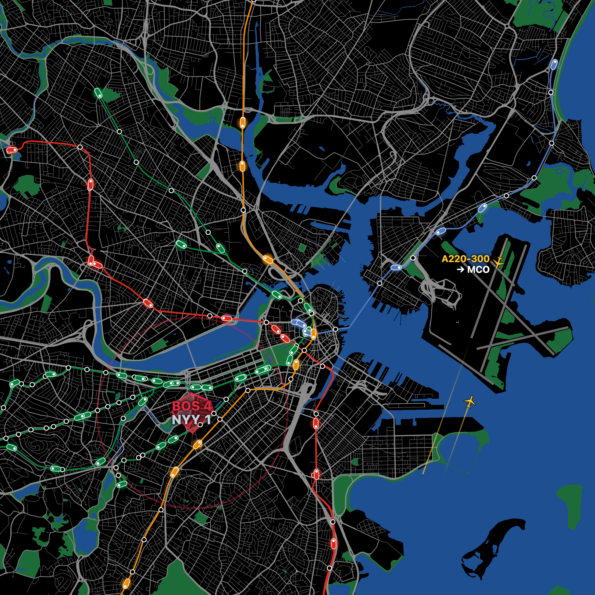
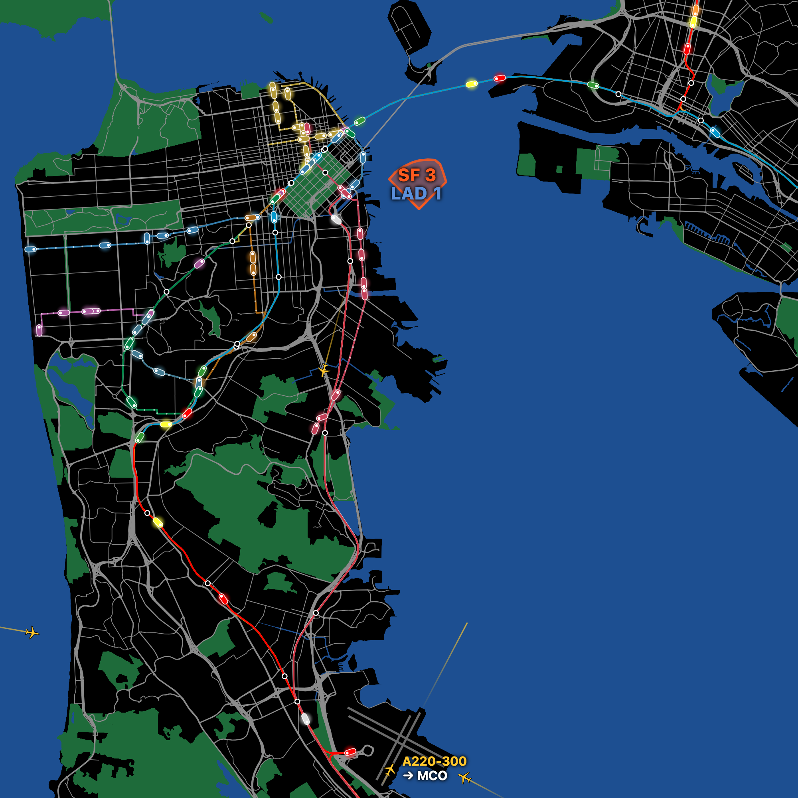

# Pulse Map

A live city map made for a projector on your wall. Trains glide along their tracks, weather drifts
across, stadiums light up during games, and planes take off and land.

It's drawn for a projector: a square, mostly black map (black is "no light"), with no labels except
a few scores and call-outs.

<p align="center">
  
  
</p>
<p align="center"><sub>Boston (left) and San Francisco (right). Trains are real (BART and Caltrain from their timetables); the games and planes shown use the preview modes.</sub></p>

## Cities

| City | Transit | Sports | Airport |
| --- | --- | --- | --- |
| **Boston** (default) | MBTA subway: Red, Mattapan, Orange, Green B–E, Blue (live) | Celtics, Bruins, Red Sox | Logan (BOS) |
| **San Francisco** (`?city=sf`) | Muni Metro, F line and cable cars (live); BART and Caltrain (timetable) | Giants, Warriors, Valkyries | SFO |

## What's on the wall

- **Trains:** line-colored capsules with a headlight showing which way they're heading, gliding along
  the real track between updates. Stations are white rings; minor street stops are small dots.
- **Weather:** live conditions drawn over the map: rain, drizzle, snow, fog and clouds blown by the
  real wind, plus lightning strikes in storms.
- **Sports:** during a home game the stadium appears (Fenway's and Oracle Park's real outfield
  shapes, courts and rinks) with the score. Each score sends out a ping, and wins get a celebration.
- **Planes:** live aircraft with short fading trails. Takeoffs and landings get a short run along
  the matching runway with the plane type and where it's going or coming from.
- **DEMO badge:** a small corner badge appears whenever anything shown is simulated rather than live.

## Quick start

```bash
npm install
npm run dev
```

Then open `http://localhost:5173` (or `http://localhost:5173/?city=sf`).

**San Francisco transit** needs a free [511.org token](https://511.org/open-data/token). Copy
`.env.example` to `.env.local` and fill in `TRANSIT_511_API_KEY`. Only the dev server reads it; it
never reaches the browser or git. Without a token, San Francisco shows everything except Muni,
Caltrain and the Muni stops.

### On a projector

1. Set the projector as an **extended** display (System Settings → Displays), not a mirror.
2. Open the page in Chrome, drag the window onto the projector, and press **Ctrl + Cmd + F** for
   full screen (untick View → "Always Show Toolbar in Full Screen" if the address bar stays).
3. Keep the Mac awake with `caffeinate -d` in a terminal.

The wall is square, so a widescreen projector shows black bars, which project as darkness.

## Preview controls

Click the wall first so it gets key presses.

| URL / key | What it does |
| --- | --- |
| `?city=sf` | Show San Francisco instead of Boston |
| `D` key, or `?sports=<team>` (e.g. `redsox`, `giants`) | Cycle sports: live → a never-ending home game for each of the city's teams |
| `?planes=demo` | Scripted air traffic with takeoffs and landings at the city's airport |
| `W` key, or `?weather=rain` (`clear`, `cloudy`, `fog`, `drizzle`, `storm`, `snow`) | Force a weather look |
| `S` key, or `?sky=dusk` (`day`, `night`, `dawn`) | Force a time of day (the live wall stays in daylight) |

## Customizing

Everything about a city lives in its own folder under `src/cities/`:

| File | What's in it |
| --- | --- |
| `src/cities/<city>/index.ts` | The view (center, places that must fit on the wall) and which features the city has |
| `src/cities/<city>/sports.ts` | Teams, and where and how big each stadium is drawn. Safe to tweak, with notes on how far a number moves things |
| `src/cities/<city>/airport.ts` | Airport code, position, runways, and which runways the demo traffic uses |
| `src/sports/tuning.ts` | Stadium look shared by every city: outline width, fill, score text size |

Save a file and the wall reloads by itself.

**Adding a city:** copy `src/cities/sanFrancisco/`, fill it in, and list it in `src/cities/index.ts`.
Features are optional: leave out `transit`, `sportsTeams` or `airport` and the wall simply doesn't
show it. Weather is always on.

## How it works

| Folder | What it does |
| --- | --- |
| `src/cities/` | Per-city configuration (above) |
| `src/trains/`, `src/transit/` | Drawing trains, snapping them to track geometry, timetable placement; the `TransitProvider` interface |
| `src/mbta/` | MBTA (Boston) transit provider |
| `src/sports/` | ESPN scores, stadium shapes, pings and previews |
| `src/planes/` | ADS-B aircraft, runway detection, runway runs and labels |
| `src/weather/` | Open-Meteo weather and the effects canvas |
| `src/net/` | `politeFetch` (rate-limit guard shared across reloads and tabs) and a day-long cache |
| `server/` | Dev-server plugin: Bay Area transit via 511.org and agency GTFS feeds |

The dev server (`vite.config.ts`) adds two things the browser can't do on its own:

- `/adsb`: a proxy to adsb.fi, which doesn't allow browser requests from other sites.
- `/api/transit/*`: Bay Area transit (`server/transitPlugin.ts`). It keeps the 511 key server-side,
  reduces each agency's GTFS feed to rail lines, stations and daily timetables (downloaded weekly and
  cached in `node_modules/.cache/pulse-map`), and serves live Muni positions.

Because of that, **planes and San Francisco transit only work under `npm run dev`** for now. A plain
static build would need its own small proxy.

## Data sources and rate limits

Every request goes through `src/net/politeFetch.ts`, which spaces requests per service (remembered
across page reloads and tabs) and backs off for at least a minute on a `429`. Slow-changing data is
cached.

| Data | Source | Their limit | We use |
| --- | --- | --- | --- |
| Boston trains, lines, stations | [MBTA V3 API](https://api-v3.mbta.com) | 20/min without a key | ≈ 6/min; lines and stations cached for a day |
| SF Muni live positions | [511.org](https://511.org/open-data/transit) (your token) | 60/hour per token | 1 per 75 s from the dev server, shared by all tabs; pauses when 511 reports ≤ 5 left |
| Muni and Caltrain schedules | 511.org GTFS feeds | (same budget) | 1 download per agency per week, cached on disk |
| BART schedule | [BART GTFS](https://www.bart.gov/schedules/developers/gtfs) | none published | 1 download per week, cached on disk |
| Weather | [Open-Meteo](https://open-meteo.com) | 10,000/day, non-commercial | 1 per 10 min |
| Scores | ESPN public scoreboard (unofficial) | none published | ≥ 5 s apart; every 30 s during a live game, 5 min otherwise |
| Planes | [adsb.fi open data](https://adsb.fi) | 1/sec, personal non-commercial use | 1 per 10 s |
| Flight routes | [adsbdb](https://www.adsbdb.com) | none published | Only on takeoffs and landings, cached, ≥ 5 s apart |

BART publishes no live train positions, and live Caltrain would exceed 511's hourly budget, so those
trains move along their tracks by the published timetable. Muni and MBTA trains are live.

**Credits:** map data © [OpenStreetMap](https://www.openstreetmap.org/copyright) contributors, tiles by
[OpenFreeMap](https://openfreemap.org). Transit data from the MBTA, [511.org](https://511.org) (Muni,
Caltrain) and BART. Aircraft data from [adsb.fi](https://adsb.fi). Route data via adsbdb (David Taylor
and Jim Mason's flight route data). Weather by [Open-Meteo](https://open-meteo.com).

## Development

```bash
npm test          # unit tests (Vitest)
npx tsc           # type check
npm run build     # production build
```

In development, the map is available in the browser console as `pulseMap` for inspecting layers.

## License

The code is released under the [MIT License](LICENSE): use it, change it, and share it freely.

The live data it shows comes with its own terms, which still apply when you run it. In particular,
adsb.fi aircraft data is for personal, non-commercial use and must be credited, adsbdb's route data
may not be copied into other databases, and 511.org data is provided under its own Terms & Conditions
to each token holder. See each source's site (linked above) before using the data for anything beyond
a personal wall.
